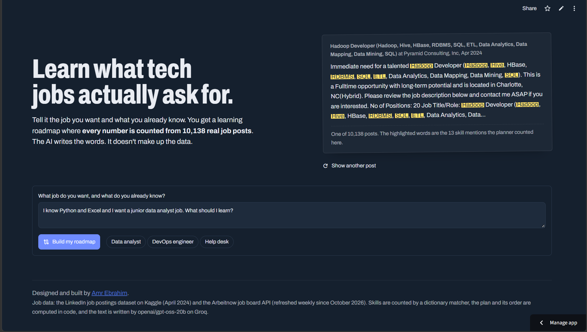
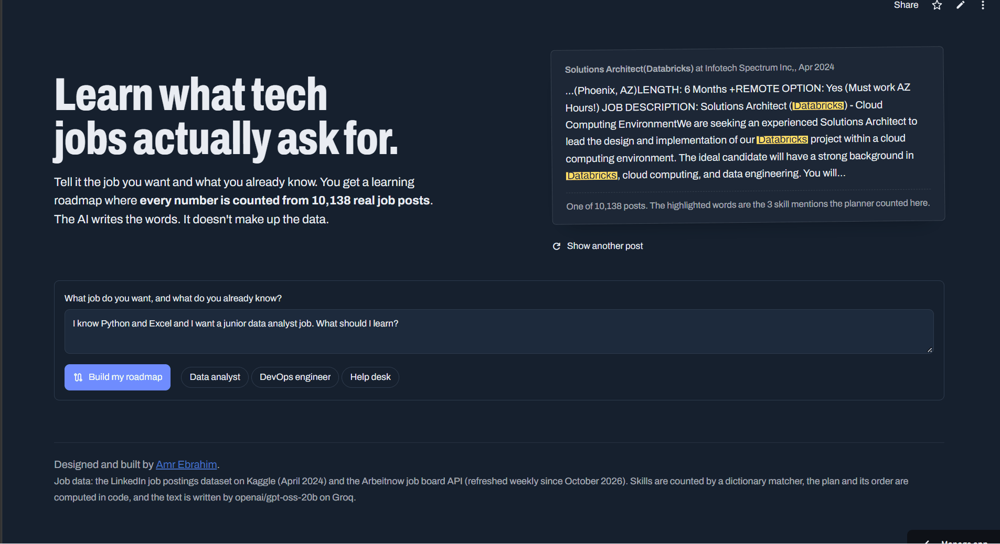
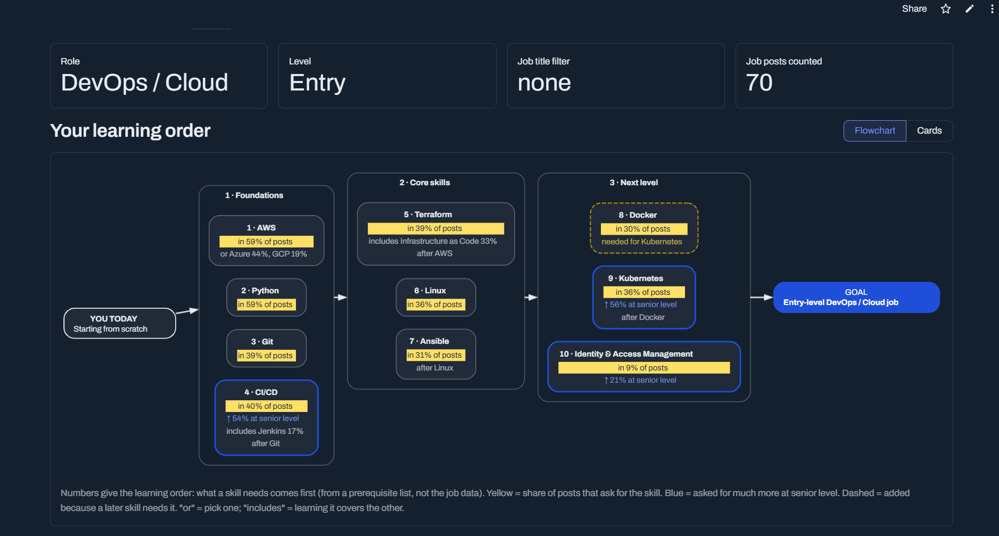
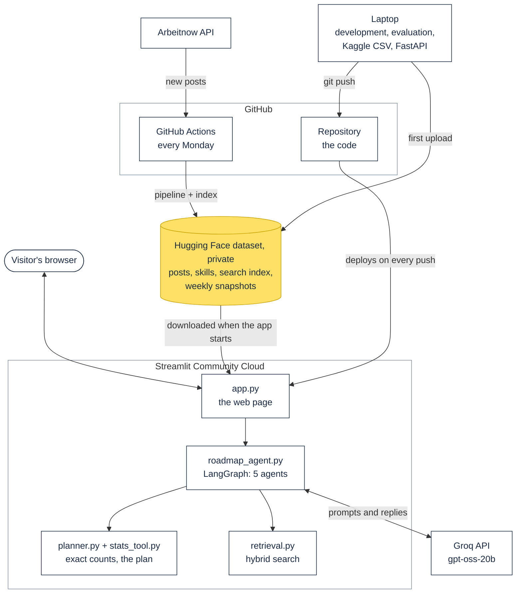
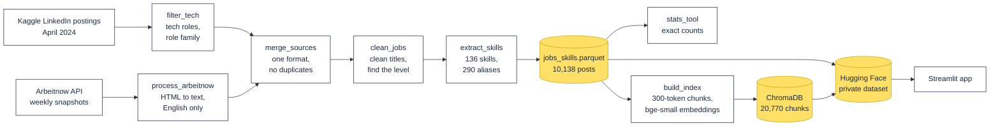

<p align="center">
  
</p>

<p align="center">
  <a href="https://career-roadmap-bgevtqzghvkn3mj7i5ppr7.streamlit.app/"><b>Live demo</b></a> ·
  <a href="#architecture">Architecture</a> ·
  <a href="#how-it-works">How it works</a> ·
  <a href="#the-data">The data</a> ·
  <a href="#evaluation">Evaluation</a> ·
  <a href="#run-it-yourself">Run it yourself</a>
</p>

<p align="center">
  
  
  
  
  
  
  
</p>

---

Ask an AI what to learn for your first tech job and you get a confident list that nobody counted.
**Career Roadmap Builder works the other way around.** It reads 10,138 real job posts, counts which
skills employers ask for at your level, orders them by what you need to learn first, and backs
every step with quotes from actual posts. A team of agents does the work, but the numbers never
come from a language model: they are computed in code, and every number and quote in the final text
is checked against the data before you see it.

> **You:** "I know Python and Excel and I want a junior data analyst job."
>
> **The app:** counts 114 entry-level analyst posts, finds that **SQL is in 44%** of them (and in
> 78% at senior level), that you already have Excel (42%), and builds a numbered path: SQL, then
> Statistics, then Power BI *or* Tableau, with a real job post quoted for each step.

<p align="center">
  
</p>

## What makes it different

| Most AI career advice | This project |
|---|---|
| The model guesses what is "in demand" | **Exact counts** over 10,138 posts, done with pandas |
| Numbers you can't check | Every percentage traces back to the posts it was counted from |
| Examples that may be invented | Every quote is checked **word for word** against the cited post |
| One big prompt | Five agents; only three of them use an LLM, and only for language |
| "Learn Docker, Kubernetes, AWS, Azure…" | A **learning order**: prerequisites first, alternatives grouped as "pick one" |
| Trust me | Evaluated with DeepEval and a custom metric (0.96–0.98 citation faithfulness), and the judge itself was validated |

## How it works

<a id="how-it-works"></a>

Five agents in a [LangGraph](https://github.com/langchain-ai/langgraph) graph. Yellow steps are
plain code, white steps use the LLM.


| Agent | Runs on | What it does |
|---|---|---|
| **Intake** | LLM, structured output | Turns free text into a role family, a level, a job-title keyword and the skills you already have. Groq's constrained decoding (`json_schema`, `strict`) guarantees a valid schema. |
| **Planner** | Code | Counts every skill across all matching posts, removes what you already know, builds three phases, marks skills that **rise with seniority** (10+ points from entry to senior, only when both levels have 30+ posts), groups alternatives and orders the steps by prerequisites. |
| **Researcher** | Code | One hybrid search per phase, keeps the 3 best posts, numbers them as sources `[1]`, `[2]`… |
| **Writer** | LLM | Writes the roadmap from the plan and the excerpts. It may search again only during its one revision, at most twice. The limit is enforced in code by not giving it the tool. |
| **Critic** | LLM + code | An LLM review plus deterministic checks (below). If anything is wrong, the draft goes back once; anything left is shown to you as a reviewer note instead of being hidden. |

<p align="center">
  
</p>

### The checks that run in code

An LLM reviewer misses things and sometimes invents problems, so the rules that can be exact are exact:

- **Citations:** every `[n]` must point to a source that exists.
- **Quotes:** every quoted example must appear **word for word** in the excerpt the writer was shown, and must mention the skill it illustrates.
- **Trends:** "rises" or "falls with seniority" is only allowed where the planner marked it.
- **No vague claims:** words like *most*, *typical* or *commonly* are flagged in the data part; give the number instead.
- **Advice stays advice:** the "General advice (not from the job data)" section may not contain numbers or claims about job posts.

### The learning order

The planner knows which skills take others first (`prereqs.py`, 69 hand-written rules such as
*Kubernetes needs Docker, Docker needs Linux*). It walks the plan depth-first, places every
prerequisite before the skill that needs it, and adds a missing one when needed, marked
*"needed for Kubernetes"*. Alternatives (AWS / Azure / GCP, Power BI / Tableau…) become one step
with "or …", and overlapping topics (Terraform and Infrastructure as Code) become one step with
"includes …". The order comes from these rules; the percentages come from the posts. The app
labels the two separately.

<p align="center">
  
</p>

## Architecture

How the pieces connect, from your browser to the weekly data refresh:



- **The app** runs everything in one process on Streamlit Community Cloud: the page, the agents, the planner and the search. Only the language steps leave it, as calls to Groq.
- **The data** lives in a private Hugging Face dataset, not in git. The app downloads it once when it starts (about 380 MB: the search index and the skill table).
- **The weekly refresh** runs on GitHub's machines (`.github/workflows/weekly-refresh.yml`): it downloads the current data, fetches the week's Arbeitnow posts, runs the pipeline, embeds only the new chunks and uploads the result. The app picks it up the next time it starts.
- **The laptop** is where the code is written and evaluated. It is also the only place with the raw Kaggle file (`postings.csv`); the pipeline reuses its filtered version everywhere else.
- **`api.py`** (FastAPI) exposes the same agent as `POST /roadmap` for local use; the page can run against it with `ROADMAP_API_URL`.

## The data



### From 132,828 posts to 10,138

| Step | Kaggle | Arbeitnow | Total |
|---|---|---|---|
| Collected | 123,849 | 9,070 in 2 weekly snapshots (8,979 unique) | |
| Tech roles only (Arbeitnow: also English only) | 9,663 (7.8%) | 1,280 | 10,943 |
| Exact duplicates removed | | | 10,175 (−768) |
| Descriptions under 200 characters removed | 8,881 | 1,257 | **10,138** (−37) |
| At least one known skill, so indexed | | | 9,683 posts, **20,770 chunks** |

### 1. Collecting

- **Kaggle:** the [LinkedIn Job Postings](https://www.kaggle.com/datasets/arshkon/linkedin-job-postings) dataset, 123,849 posts from April 5–20, 2024, mostly in the US. Downloaded once.
- **Arbeitnow:** a free job board API, mostly Europe. `fetch_arbeitnow.py` follows every page, waits and retries when the API answers "too many requests", and saves each fetch as a dated snapshot that is never overwritten. Posts disappear from the board within about a week (only 91 overlapped between two fetches a week apart), so every snapshot is kept and the history grows.

### 2. Keeping the tech jobs: `roles.py`

A post is kept when its **title** matches one of 11 role families. The families are tried in a fixed order and the first match wins, so a "Machine Learning Engineer" is AI/ML, not general software.

| Family | Matched by (examples) |
|---|---|
| AI / ML | machine learning, ML, MLOps, deep learning, NLP, computer vision, LLM; "AI" only next to engineer, developer, scientist… |
| Data | data scientist / engineer / analyst, analytics engineer, BI, ETL, DBA, SQL developer |
| Security | cybersecurity, information security, SOC analyst, penetration tester, AppSec, DevSecOps |
| DevOps / Cloud | DevOps, SRE, platform / infrastructure engineer, cloud engineer, solutions architect |
| Mobile, Frontend, Backend | iOS, Android, Flutter · front-end, UI, web developer · back-end, Java / Python / .NET / Node developer |
| QA | QA engineer / analyst, SDET, test automation, software tester |
| Networking / IT | network engineer, help desk, service desk, desktop support, system administrator, IT support |
| Software | software, developer, programmer, full stack (the catch-all, tried last) |

Three kinds of rules keep the families honest:

- **An exclusion list runs first:** sales, recruiter, marketing, account manager, product or project manager, underwriter, volunteer, course developer and similar titles are never tech posts, whatever else they say.
- **Re-labels run after a family is found,** so they move posts between families but never add new ones: architect titles get their own *architecture* family (except data and ML architects), and "Salesforce Commerce Cloud Developer"-style titles don't count as DevOps just because they contain "Cloud".
- **"AI" alone isn't enough:** "AI Growth Manager" and "Head of AI" are not hands-on roles, so "AI" counts only next to a word like engineer, developer or scientist.

### 3. Cleaning the Arbeitnow posts: `process_arbeitnow.py`

- All snapshots are combined and each post is kept **once, in its newest version**.
- Descriptions arrive as HTML: they are unescaped and turned into plain text with Beautiful Soup.
- **English only:** `langdetect` reads the first 1,000 characters (with a fixed seed, so the result never changes between runs). Much of the board is in German.
- The same title rules decide the role family, and the posts are mapped to the Kaggle columns, with `source` marking where each one came from.

### 4. Merging: `merge_sources.py`

IDs get a `kaggle_` / `arbeitnow_` prefix so they can never collide, the remote flag gets one format, and **768 exact duplicates** (same title, company and description) are removed.

### 5. Cleaning titles and finding the level: `clean_jobs.py`, `cleaning.py`

**Titles are cleaned** before anything reads them (the original stays in `title_raw`): gender tags like *(m/w/d)* and *(all genders)*, staffing notes like *W2 only*, *No C2C*, *Locals only*, *USC/GC*, *Urgent need*, job codes like *(REQ-12345)* or *R-123456*, bracketed tags and stray punctuation all go.

**The level** comes from the first source that has it:

1. **The title**, checked in this order: intern (intern, trainee, apprentice, working student), leadership (head of, director, VP, manager), senior (senior, sr, staff, principal, lead, architect, III), entry (junior, jr, entry-level, graduate, associate, I, II), mid (mid-level, intermediate).
2. **The posting's own label** (Kaggle only). LinkedIn's "Mid-Senior level" covers both, so it counts as **mid**, not senior.
3. **Years of experience in the text**, such as "3+ years of experience" or "2–4 yrs of hands-on experience" (up to 15; the smallest number counts): under 3 is entry, 3–4 mid, 5 or more senior.

The years also **correct** titles that understate the job: an "entry-level" or intern post that asks for 3+ years is moved up to the level those years mean.

Finally, posts whose description is **under 200 characters** are dropped (37 posts): there is nothing to count in them.

| Level | Posts |
|---|---|
| Senior | 4,286 |
| Mid | 2,418 |
| Entry | 1,679 |
| Unknown | 1,120 |
| Leadership | 442 |
| Intern | 193 |

### 6. Finding the skills: `skills_dict.py`, `skill_matcher.py`, `extract_skills.py`

- **136 skills in 17 categories, written as 290 regular-expression aliases:** `k8s` and `OpenShift` count as Kubernetes, `PostgreSQL` and `Postgres` as PostgreSQL, `Network+` and `A+` as CompTIA.
- **Word edges that understand tech names:** `+` and `#` count as part of a word, so `C#`, `C++` and `Network+` are matched whole, and `Java` never matches inside `JavaScript`.
- **Case-sensitive names:** `R`, `Go`, `REST`, `Spark`, `Excel`, `SAS`, `Swift`, `Rust`, `Ruby`, `iOS` and `React` only match with that exact capitalization (and `R` and `Go` only next to words like *programming* or *language*, or inside a list), so "go to market" is not Go.
- **Glued words:** many LinkedIn descriptions lost their line breaks ("experience using PostgresKnowledge of…"), so a skill may end where a new capitalized word begins.
- **Result:** 9,683 posts (95.5%) mention at least one skill, 7.1 on average.

### 7. The search index: `chunking.py`, `build_index.py`, `sync_index.py`

- Each description is split into **300-token chunks with 50 tokens of overlap**, counted with the embedding model's own tokenizer.
- Each chunk starts with a header (*title | family | level*), so a search for "junior data analyst" can match the job even when the text doesn't repeat it.
- **Chunks that mention no skill are left out:** benefits, company history and legal text don't help a skills search.
- Chunks are embedded with `BAAI/bge-small-en-v1.5` (384 dimensions, normalized) and stored in ChromaDB with the post's metadata: ID, title, company, family, level, source, remote, date, URL and skills.
- `build_index.py` only embeds chunks that aren't in the index yet, and `sync_index.py` updates changed families and levels and deletes chunks of posts that left the data, without re-embedding.

### The numbers

| | |
|---|---|
| **Posts** | 10,138 tech posts: 8,881 from Kaggle (US, April 2024) and 1,257 from Arbeitnow (mostly Europe, since October 2026) |
| **Role families** | software 3,421 · data 1,622 · networking/IT 1,351 · security 688 · DevOps/cloud 669 · AI/ML 653 · backend 610 · architecture 451 · frontend 301 · mobile 191 · QA 181 |
| **Skills** | 136 skills in 17 categories, 290 aliases; 7.1 per post on average |
| **Search index** | 20,770 chunks of 300 tokens |

### Hybrid search

Vector search finds posts with the same meaning; keyword search finds exact names like
`CompTIA A+` or `Terraform`. `retrieval.py` runs both and merges the rankings:

- **Vector:** ChromaDB with cosine similarity, plus a small freshness bonus for newer posts.
- **Keyword:** a BM25 implementation written from scratch (k1 = 1.5, b = 0.75) on a scikit-learn sparse matrix, with a tokenizer that keeps `c#`, `c++`, `node.js` and `network+` whole.
- **Merge:** Reciprocal Rank Fusion (k = 60).

### What the data taught me

These came out of checking the numbers instead of trusting them:

- **The "senior DevOps" dip was a labeling problem.** 332 of 585 senior DevOps/cloud posts were architect roles that list half as many skills (5.5 vs 10.7). They now have their own family.
- **"AI" in a title doesn't make a job hands-on.** Sales and partner roles with "AI" in the title were counted as AI/ML. Requiring an engineering word removed 165 of them.
- **The job title changes the answer.** For entry-level data jobs, Python is in 45% of all posts but only 23% of *analyst* posts, while Excel goes from 22% to 42%. The planner narrows by title when there are enough posts and says so when there aren't.
- **Job boards forget fast.** Only 91 posts overlapped between two Arbeitnow fetches a week apart, so every weekly snapshot is kept.
- **Two sources, two worlds.** The Kaggle posts are US, April 2024; Arbeitnow is mostly Europe, 2026. Trends over time are measured inside one source only.

## Evaluation

<a id="evaluation"></a>

Two things are evaluated: the plain RAG that answers questions about the posts, and the full
roadmap agent.

| What | Score |
|---|---|
| RAG citation faithfulness (7 questions) | **0.98** |
| Agent citation faithfulness (8 roadmaps) | **0.96** |
| Agent: right role and level understood | **8 / 8** |
| Agent: numbers that are not in the plan | **0** |
| Agent: citations to sources that don't exist | **0** |

### The RAG

The plain RAG (retrieve 5 posts, answer with citations) is evaluated with
[DeepEval](https://github.com/confident-ai/deepeval) on 7 fixed questions, with Groq's
`gpt-oss-120b` as the judge.

| Run | Search | Citation faithfulness | Answer relevancy | Contextual relevancy |
|---|---|---|---|---|
| Baseline (RAG by hand) | vector | **0.98** | 1.00 | 0.63 |
| LangChain version | vector | *pending* | *pending* | *pending* |
| Hybrid | BM25 + vector | *pending* | *pending* | *pending* |

**Citation faithfulness is a custom metric.** DeepEval's built-in faithfulness first condenses the
sources into a list of "truths", losing the source numbers, so it flagged correct lines and gave
scores as low as 0.00 to answers whose citations were right. `citation_faithfulness.py` checks
every answer line against the **raw text of the sources that line cites**, in one judge call:
supported (1), partly (0.5) or unsupported (0), plus which items are missing and whether they
appear in a source the line didn't cite (a wrong citation).

**The judge was checked too.** `check_skills.py` is an independent, free check: it runs the skills
dictionary over each answer line and its cited posts. Where it disagreed with the judge, I read
the posts by hand: in 4 of the 5 cases the post really said it and the judge was right (the 5th
was a borderline paraphrase). The disagreements exposed **two bugs in the skill extractor**:
missing spellings (`no-sql`, `Service Now`, `identity & access management`) and words glued
together by lost line breaks (`PostgresKnowledge`). The glued-words fix alone recovered
**1,542 skill mentions** across the data (+2.2%).

Every eval run saves the exact sources next to each answer, so results can be re-checked later
even after the data changes.

### The roadmap agent

`eval_agent.py` builds a roadmap for 8 requests, one per kind of job (data analyst, DevOps,
help desk, backend, frontend, security analyst, machine learning, QA), and checks each one.
Most checks are plain code, so they are free and exact:

| Check | What it measures | Result |
|---|---|---|
| Intake | the request was read as the right role family and level | **1.00** (8/8) |
| Plan coverage | every skill in the plan appears in the roadmap | **1.00** |
| Numbers | every percentage in the roadmap is a number from the plan | **1.00** |
| Learning order | skills are introduced in the planned order | 0.88 |
| Citations | every `[n]` points to a source that exists | 0 invalid |
| Citation faithfulness | LLM judge, the custom metric above | **0.96** |

**My first agent score was 0.54, and the agent wasn't the problem.** The judge only saw the
job-post excerpts, but a roadmap's percentages, post counts and learning order come from the
plan, which code counts over *all* matching posts. Reading the judge's reasons showed it: almost
everything it marked as unsupported was a correct plan number ("SQL: in 44% of the posts"),
a step ("learn after SQL") or the "General advice" section, which is outside the data on
purpose. Now the metric takes the plan as a second kind of evidence: numbers and order are
checked against the plan, examples `[n]` against the post they cite, and the advice section is
left out. `rescore_agent.py` judged the 8 saved roadmaps again without rebuilding them:
**0.54 → 0.96**, with no line left unsupported.

What the judge still flags is real: a few examples cite a post that doesn't mention the skill
(for example an AWS example from a post without the word AWS). The evaluation also found two
bugs that are being fixed: the LLM critic's structured reply was cut off in 6 of 8 runs (its
reasoning used up the token budget, so only the code checks ran), and the planner added Kotlin
and Swift to help desk roadmaps because help desk posts ask for Android and iOS *support*.

## Design decisions

1. **LLMs only where language is needed.** Reading a request, writing prose and reviewing it need a language model. Counting, planning, ordering and searching don't, so they are code: the same request always gets the same plan.
2. **Change what the model sees, not only what you ask.** When the writer saw every entry-vs-senior number, it invented "rises with seniority" from small differences, even after being told not to. Now the plan shows seniority numbers only for skills that pass the 10-point rule, and the problem is gone.
3. **Exact rules belong in code.** A prompt told the writer to search only while revising; it searched until LangGraph stopped it at 25 steps. Groq rejects `tool_choice="none"` when gpt-oss still tries to call a tool, so now the writer simply gets no tool when it must write.
4. **A checker must be precise.** An early quote check only stored the first excerpt of each post. Its false alarms sent correct drafts back, and the rewrites got worse.
5. **Free, end to end.** Groq's free tier, a free Hugging Face dataset and Streamlit Community Cloud. The server installs CPU-only PyTorch (`make_requirements.py`), because the default Linux build pulls about 3 GB of GPU libraries.

## Tech stack

| Area | Tools |
|---|---|
| Language | Python 3.11 |
| Data | pandas, PyArrow (Parquet), Requests (Arbeitnow API), Beautiful Soup, langdetect |
| Skill extraction | A hand-built regex dictionary (`skills_dict.py`, `skill_matcher.py`) |
| Embeddings | sentence-transformers with `BAAI/bge-small-en-v1.5`, PyTorch (CPU) |
| Vector store | ChromaDB |
| Keyword search | BM25 written from scratch on scikit-learn's `CountVectorizer`, NumPy, SciPy sparse matrices |
| LLMs | Groq API: `openai/gpt-oss-20b` for the agents, `openai/gpt-oss-120b` as the evaluation judge |
| Agents | LangGraph (`StateGraph`, `ToolNode`, conditional edges), LangChain Core (tools, messages, prompt templates), `langchain-groq` |
| Validation | Pydantic: structured LLM output and API request models |
| Evaluation | DeepEval (custom `BaseMetric`, AnswerRelevancy, ContextualRelevancy) with a custom Groq judge |
| API | FastAPI + Uvicorn |
| Web app | Streamlit: chat messages for the agents, a Graphviz flowchart, light and dark themes, custom CSS |
| Data hosting | Hugging Face Hub (private dataset, `huggingface_hub`) |
| Deployment | Streamlit Community Cloud, secrets for the API keys |
| Config | python-dotenv |

## Run it yourself

<a id="run-it-yourself"></a>

**1. Install** (Python 3.11)

```bash
git clone https://github.com/Amr-Ebrahim/career-roadmap.git
cd career-roadmap
python -m venv .venv
.venv\Scripts\activate          # Windows;  source .venv/bin/activate on macOS/Linux
pip install -r requirements-dev.txt
```

`requirements-dev.txt` has everything (pipeline, evaluation, app). `requirements.txt` is the lean
list the online app installs, generated by `make_requirements.py`.

**2. Keys:** create a `.env` file (never committed):

```bash
GROQ_API_KEY=your_groq_key             # free at console.groq.com
HF_TOKEN=your_hugging_face_token       # only to upload or download the prepared data
DEEPEVAL_TELEMETRY_OPT_OUT=YES
```

**3. Data:** build it from the sources:

```bash
# put postings.csv from the Kaggle dataset in data/raw/
python fetch_arbeitnow.py      # saves data/raw/arbeitnow/<date>.json
python run_pipeline.py         # filter, merge, clean, extract skills -> data/processed/jobs_skills.parquet
python build_index.py          # chunks + embeddings -> data/chroma
```

**4. Start the app**

```bash
streamlit run app.py
```

The page runs the agents itself. To run them behind the API instead:

```bash
uvicorn api:app --port 8000                     # API docs at http://127.0.0.1:8000/docs
set ROADMAP_API_URL=http://127.0.0.1:8000       # macOS/Linux: export ROADMAP_API_URL=...
streamlit run app.py
```

**Evaluate**

```bash
python eval_rag.py baseline                               # or: langchain, hybrid
python rescore_citation.py evals/baseline_<date>.csv      # re-judge saved answers
python check_skills.py evals/baseline_<date>.csv          # independent dictionary check, no LLM
python eval_agent.py                                      # the full agent, 8 requests (--no-judge: code checks only)
python rescore_agent.py evals/agent_<date>.csv            # re-judge saved roadmaps without rebuilding them
```

**Weekly refresh:** runs by itself every Monday on GitHub (`.github/workflows/weekly-refresh.yml`), or by hand from the Actions tab. It needs a Hugging Face write token as the secret `HF_TOKEN` and the dataset name as the variable `HF_DATA_REPO`. To run the same steps on your machine:

```bash
python hf_data.py download --all     # the current data, including the weekly snapshots
python fetch_arbeitnow.py && python run_pipeline.py && python build_index.py && python sync_index.py
python hf_data.py upload
```

## Project structure

```
app.py                  Streamlit page: hero, agents at work, flowchart, sources
api.py                  FastAPI: GET /health, POST /roadmap
roadmap_agent.py        LangGraph pipeline and the critic's code checks
planner.py              gap finder, phases, trends, groups, learning order (no LLM)
prereqs.py              hand-written prerequisites and skill groups
stats_tool.py           exact skill counts over all posts
search_tool.py          the search tool the agents use, with numbered sources
retrieval.py            vector + BM25 hybrid search, Reciprocal Rank Fusion
rag_by_hand.py          plain RAG with citations, written by hand
rag_langchain.py        the same RAG with LangChain
skills_dict.py          the skill dictionary
skill_matcher.py        finds the dictionary's skills in text
roles.py                role families and re-labeling rules
fetch_arbeitnow.py      weekly job board snapshots
run_pipeline.py         filter_tech -> process_arbeitnow -> merge_sources -> clean_jobs -> extract_skills
cleaning.py             title cleaning, level rules, years of experience
chunking.py             300-token chunks with a header; chunks without skills are skipped
build_index.py          chunking and embeddings into ChromaDB
sync_index.py           keeps the index in step with the data
hf_data.py              uploads / downloads the data (Hugging Face dataset)
pipeline_stats.py       how many posts survive each step
.github/workflows/      weekly-refresh.yml: the Monday data refresh
eval_rag.py             DeepEval runs: baseline, LangChain, hybrid
eval_agent.py           the full agent on 8 requests: code checks + the judge
rescore_agent.py        re-judges saved roadmaps
citation_faithfulness.py  the custom metric (checks against the plan too, for roadmaps)
groq_judge.py           Groq as DeepEval's judge model
check_skills.py         independent check of the judge, no LLM
make_requirements.py    requirements.txt (app) and requirements-pipeline.txt (weekly refresh)
.streamlit/config.toml  light and dark themes
```

## Limitations and next steps

- **Snapshot data:** the LinkedIn posts are from April 2024 and mostly US; the Arbeitnow posts are mostly European. Percentages describe these posts, not the whole market.
- **A dictionary finds only what it knows.** A skill that isn't in `skills_dict.py` can't be counted; the planner tells you when one of your skills isn't in it.
- **Free tiers:** about 200,000 Groq tokens per model per day (around ten roadmaps), and the online app sleeps after 12 hours without visitors, so the first visit after that takes a minute or two.
- **Growth:** the weekly refresh adds a few hundred posts a week. The first limit to reach is the app's memory on the free tier (2.7 GB), so older Arbeitnow posts will move to a rolling window of the last 6–12 months.
- **Retrieval brings back some HR text.** Contextual relevancy is 0.63: chunks still contain pay ranges, benefits and equal-opportunity statements. A boilerplate filter is tested (it cuts about 14% of the words and no skill) and comes with the next re-index.
- **Next:** the LangChain vs hybrid comparison above, the fixed critic and planner, then the boilerplate filter with a before/after score.

## Credits

- Job posts: the [LinkedIn Job Postings dataset](https://www.kaggle.com/datasets/arshkon/linkedin-job-postings) by arshkon on Kaggle, and the free [Arbeitnow job board API](https://www.arbeitnow.com/blog/job-board-api).
- Models: `gpt-oss` served by [Groq](https://groq.com), embeddings from [BAAI/bge-small-en-v1.5](https://huggingface.co/BAAI/bge-small-en-v1.5).

---

<p align="center">
  Designed and built by <a href="https://github.com/Amr-Ebrahim"><b>Amr Ebrahim</b></a>
</p>
