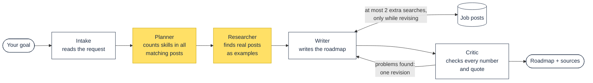
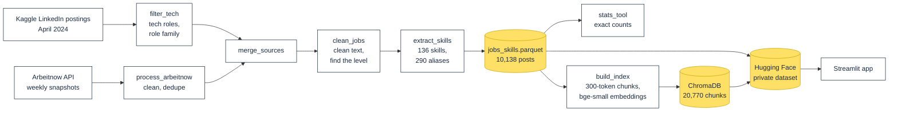

<p align="center">
  
</p>

<p align="center">
  <a href="https://career-roadmap-bgevtqzghvkn3mj7i5ppr7.streamlit.app/"><b>Live demo</b></a> ·
  <a href="#how-it-works">How it works</a> ·
  <a href="#evaluation">Evaluation</a> ·
  <a href="#run-it-yourself">Run it yourself</a>
</p>

<p align="center">
  
  
  
  
  
  
  
</p>

---

Ask an AI what to learn for your first tech job and you get a confident list that nobody counted.
**Career Roadmap Builder works the other way around.** It reads 10,138 real job posts, counts which
skills employers ask for at your level, orders them by what you need to learn first, and backs
every step with quotes from actual posts. A team of agents does the work, but the numbers never
come from a language model: they are computed in code, and every number and quote in the final text
is checked against the data before you see it.

> **You:** "I know Python and Excel and I want a junior data analyst job."
>
> **The app:** counts 114 entry-level analyst posts, finds that **SQL is in 44%** of them (and in
> 78% at senior level), that you already have Excel (42%), and builds a numbered path: SQL, then
> Statistics, then Power BI *or* Tableau, with a real job post quoted for each step.

<p align="center">
  
</p>

## What makes it different

| Most AI career advice | This project |
|---|---|
| The model guesses what is "in demand" | **Exact counts** over 10,138 posts, done with pandas |
| Numbers you can't check | Every percentage traces back to the posts it was counted from |
| Examples that may be invented | Every quote is checked **word for word** against the cited post |
| One big prompt | Five agents; only three of them use an LLM, and only for language |
| "Learn Docker, Kubernetes, AWS, Azure…" | A **learning order**: prerequisites first, alternatives grouped as "pick one" |
| Trust me | Evaluated with DeepEval and a custom metric, and the judge itself was validated |

## How it works

<a id="how-it-works"></a>

Five agents in a [LangGraph](https://github.com/langchain-ai/langgraph) graph. Yellow steps are
plain code, white steps use the LLM.



| Agent | Runs on | What it does |
|---|---|---|
| **Intake** | LLM, structured output | Turns free text into a role family, a level, a job-title keyword and the skills you already have. Groq's constrained decoding (`json_schema`, `strict`) guarantees a valid schema. |
| **Planner** | Code | Counts every skill across all matching posts, removes what you already know, builds three phases, marks skills that **rise with seniority** (10+ points from entry to senior, only when both levels have 30+ posts), groups alternatives and orders the steps by prerequisites. |
| **Researcher** | Code | One hybrid search per phase, keeps the 3 best posts, numbers them as sources `[1]`, `[2]`… |
| **Writer** | LLM | Writes the roadmap from the plan and the excerpts. It may search again only during its one revision, at most twice. The limit is enforced in code by not giving it the tool. |
| **Critic** | LLM + code | An LLM review plus deterministic checks (below). If anything is wrong, the draft goes back once; anything left is shown to you as a reviewer note instead of being hidden. |

<p align="center">
  
</p>

### The checks that run in code

An LLM reviewer misses things and sometimes invents problems, so the rules that can be exact are exact:

- **Citations:** every `[n]` must point to a source that exists.
- **Quotes:** every quoted example must appear **word for word** in the excerpt the writer was shown, and must mention the skill it illustrates.
- **Trends:** "rises" or "falls with seniority" is only allowed where the planner marked it.
- **No vague claims:** words like *most*, *typical* or *commonly* are flagged in the data part; give the number instead.
- **Advice stays advice:** the "General advice (not from the job data)" section may not contain numbers or claims about job posts.

### The learning order

The planner knows which skills take others first (`prereqs.py`, 69 hand-written rules such as
*Kubernetes needs Docker, Docker needs Linux*). It walks the plan depth-first, places every
prerequisite before the skill that needs it, and adds a missing one when needed, marked
*"needed for Kubernetes"*. Alternatives (AWS / Azure / GCP, Power BI / Tableau…) become one step
with "or …", and overlapping topics (Terraform and Infrastructure as Code) become one step with
"includes …". The order comes from these rules; the percentages come from the posts. The app
labels the two separately.

<p align="center">
  
</p>

## The data



| | |
|---|---|
| **Posts** | 10,138 tech posts: 8,881 from the LinkedIn dataset on Kaggle (US, April 2024) and 1,257 from the Arbeitnow API (mostly Europe, since October 2026) |
| **Role families** | 11: software, data, networking/IT, security, DevOps/cloud, AI/ML, backend, architecture, frontend, mobile, QA |
| **Levels** | From title rules, then the posting's own label, then "years of experience" in the text |
| **Skills** | A hand-built dictionary: 136 skills in 17 categories, 290 regex aliases, with case-sensitive rules for names like `R`, `Go` and `REST` |
| **Search index** | 20,770 chunks of 300 tokens (50 overlap), each with a header naming the job, embedded with `BAAI/bge-small-en-v1.5` |

### Hybrid search

Vector search finds posts with the same meaning; keyword search finds exact names like
`CompTIA A+` or `Terraform`. `retrieval.py` runs both and merges the rankings:

- **Vector:** ChromaDB with cosine similarity, plus a small freshness bonus for newer posts.
- **Keyword:** a BM25 implementation written from scratch (k1 = 1.5, b = 0.75) on a scikit-learn sparse matrix, with a tokenizer that keeps `c#`, `c++`, `node.js` and `network+` whole.
- **Merge:** Reciprocal Rank Fusion (k = 60).

### What the data taught me

These came out of checking the numbers instead of trusting them:

- **The "senior DevOps" dip was a labeling problem.** 332 of 585 senior DevOps/cloud posts were architect roles that list half as many skills (5.5 vs 10.7). They now have their own family.
- **"AI" in a title doesn't make a job hands-on.** Sales and partner roles with "AI" in the title were counted as AI/ML. Requiring an engineering word removed 165 of them.
- **The job title changes the answer.** For entry-level data jobs, Python is in 45% of all posts but only 23% of *analyst* posts, while Excel goes from 22% to 42%. The planner narrows by title when there are enough posts and says so when there aren't.
- **Job boards forget fast.** Only 91 posts overlapped between two Arbeitnow fetches a week apart, so every weekly snapshot is kept.
- **Two sources, two worlds.** The Kaggle posts are US, April 2024; Arbeitnow is mostly Europe, 2026. Trends over time are measured inside one source only.

## Evaluation

<a id="evaluation"></a>

The plain RAG (retrieve 5 posts, answer with citations) is evaluated with
[DeepEval](https://github.com/confident-ai/deepeval) on 7 fixed questions, with Groq's
`gpt-oss-120b` as the judge.

| Run | Search | Citation faithfulness | Answer relevancy | Contextual relevancy |
|---|---|---|---|---|
| Baseline (RAG by hand) | vector | **0.98** | 1.00 | 0.63 |
| LangChain version | vector | *pending* | *pending* | *pending* |
| Hybrid | BM25 + vector | *pending* | *pending* | *pending* |

**Citation faithfulness is a custom metric.** DeepEval's built-in faithfulness first condenses the
sources into a list of "truths", losing the source numbers, so it flagged correct lines and gave
scores as low as 0.00 to answers whose citations were right. `citation_faithfulness.py` checks
every answer line against the **raw text of the sources that line cites**, in one judge call:
supported (1), partly (0.5) or unsupported (0), plus which items are missing and whether they
appear in a source the line didn't cite (a wrong citation).

**The judge was checked too.** `check_skills.py` is an independent, free check: it runs the skills
dictionary over each answer line and its cited posts. Where it disagreed with the judge, I read
the posts by hand: in 4 of the 5 cases the post really said it and the judge was right (the 5th
was a borderline paraphrase). The disagreements exposed **two bugs in the skill extractor**:
missing spellings (`no-sql`, `Service Now`, `identity & access management`) and words glued
together by lost line breaks (`PostgresKnowledge`). The glued-words fix alone recovered
**1,542 skill mentions** across the data (+2.2%).

Every eval run saves the exact sources next to each answer, so results can be re-checked later
even after the data changes.

## Design decisions

1. **LLMs only where language is needed.** Reading a request, writing prose and reviewing it need a language model. Counting, planning, ordering and searching don't, so they are code: the same request always gets the same plan.
2. **Change what the model sees, not only what you ask.** When the writer saw every entry-vs-senior number, it invented "rises with seniority" from small differences, even after being told not to. Now the plan shows seniority numbers only for skills that pass the 10-point rule, and the problem is gone.
3. **Exact rules belong in code.** A prompt told the writer to search only while revising; it searched until LangGraph stopped it at 25 steps. Groq rejects `tool_choice="none"` when gpt-oss still tries to call a tool, so now the writer simply gets no tool when it must write.
4. **A checker must be precise.** An early quote check only stored the first excerpt of each post. Its false alarms sent correct drafts back, and the rewrites got worse.
5. **Free, end to end.** Groq's free tier, a free Hugging Face dataset and Streamlit Community Cloud. The server installs CPU-only PyTorch (`make_requirements.py`), because the default Linux build pulls about 3 GB of GPU libraries.

## Tech stack

| Area | Tools |
|---|---|
| Language | Python 3.11 |
| Data | pandas, PyArrow (Parquet), Requests (Arbeitnow API), Beautiful Soup, langdetect |
| Skill extraction | A hand-built regex dictionary (`skills_dict.py`, `skill_matcher.py`) |
| Embeddings | sentence-transformers with `BAAI/bge-small-en-v1.5`, PyTorch (CPU) |
| Vector store | ChromaDB |
| Keyword search | BM25 written from scratch on scikit-learn's `CountVectorizer`, NumPy, SciPy sparse matrices |
| LLMs | Groq API: `openai/gpt-oss-20b` for the agents, `openai/gpt-oss-120b` as the evaluation judge |
| Agents | LangGraph (`StateGraph`, `ToolNode`, conditional edges), LangChain Core (tools, messages, prompt templates), `langchain-groq` |
| Validation | Pydantic: structured LLM output and API request models |
| Evaluation | DeepEval (custom `BaseMetric`, AnswerRelevancy, ContextualRelevancy) with a custom Groq judge |
| API | FastAPI + Uvicorn |
| Web app | Streamlit: chat messages for the agents, a Graphviz flowchart, light and dark themes, custom CSS |
| Data hosting | Hugging Face Hub (private dataset, `huggingface_hub`) |
| Deployment | Streamlit Community Cloud, secrets for the API keys |
| Config | python-dotenv |

## Run it yourself

<a id="run-it-yourself"></a>

**1. Install** (Python 3.11)

```bash
git clone https://github.com/Amr-Ebrahim/career-roadmap.git
cd career-roadmap
python -m venv .venv
.venv\Scripts\activate          # Windows;  source .venv/bin/activate on macOS/Linux
pip install -r requirements-dev.txt
```

`requirements-dev.txt` has everything (pipeline, evaluation, app). `requirements.txt` is the lean
list the online app installs, generated by `make_requirements.py`.

**2. Keys:** create a `.env` file (never committed):

```bash
GROQ_API_KEY=your_groq_key             # free at console.groq.com
HF_TOKEN=your_hugging_face_token       # only to upload or download the prepared data
DEEPEVAL_TELEMETRY_OPT_OUT=YES
```

**3. Data:** build it from the sources:

```bash
# put postings.csv from the Kaggle dataset in data/raw/
python fetch_arbeitnow.py      # saves data/raw/arbeitnow/<date>.json
python run_pipeline.py         # filter, merge, clean, extract skills -> data/processed/jobs_skills.parquet
python build_index.py          # chunks + embeddings -> data/chroma
```

**4. Start the app**

```bash
streamlit run app.py
```

The page runs the agents itself. To run them behind the API instead:

```bash
uvicorn api:app --port 8000                     # API docs at http://127.0.0.1:8000/docs
set ROADMAP_API_URL=http://127.0.0.1:8000       # macOS/Linux: export ROADMAP_API_URL=...
streamlit run app.py
```

**Evaluate**

```bash
python eval_rag.py baseline                               # or: langchain, hybrid
python rescore_citation.py evals/baseline_<date>.csv      # re-judge saved answers
python check_skills.py evals/baseline_<date>.csv          # independent dictionary check, no LLM
```

**Weekly refresh**

```bash
python fetch_arbeitnow.py && python run_pipeline.py && python build_index.py && python sync_index.py
python hf_data.py upload       # the online app picks up the new data on its next start
```

## Project structure

```
app.py                  Streamlit page: hero, agents at work, flowchart, sources
api.py                  FastAPI: GET /health, POST /roadmap
roadmap_agent.py        LangGraph pipeline and the critic's code checks
planner.py              gap finder, phases, trends, groups, learning order (no LLM)
prereqs.py              hand-written prerequisites and skill groups
stats_tool.py           exact skill counts over all posts
search_tool.py          the search tool the agents use, with numbered sources
retrieval.py            vector + BM25 hybrid search, Reciprocal Rank Fusion
rag_by_hand.py          plain RAG with citations, written by hand
rag_langchain.py        the same RAG with LangChain
skills_dict.py          the skill dictionary
skill_matcher.py        finds the dictionary's skills in text
roles.py                role families and re-labeling rules
fetch_arbeitnow.py      weekly job board snapshots
run_pipeline.py         filter_tech -> process_arbeitnow -> merge_sources -> clean_jobs -> extract_skills
build_index.py          chunking and embeddings into ChromaDB
sync_index.py           keeps the index in step with the data
hf_data.py              uploads / downloads the app's data (Hugging Face dataset)
eval_rag.py             DeepEval runs: baseline, LangChain, hybrid
citation_faithfulness.py  the custom metric
groq_judge.py           Groq as DeepEval's judge model
check_skills.py         independent check of the judge, no LLM
make_requirements.py    lean requirements.txt for the server
.streamlit/config.toml  light and dark themes
```

## Limitations and next steps

- **Snapshot data:** the LinkedIn posts are from April 2024 and mostly US; the Arbeitnow posts are mostly European. Percentages describe these posts, not the whole market.
- **A dictionary finds only what it knows.** A skill that isn't in `skills_dict.py` can't be counted; the planner tells you when one of your skills isn't in it.
- **Free tiers:** about 200,000 Groq tokens per model per day (around ten roadmaps), and the online app sleeps after 12 hours without visitors, so the first visit after that takes a minute or two.
- **Next:** a weekly GitHub Action for the data refresh, an evaluation set for the full agent, and the LangChain vs hybrid comparison above.

## Credits

- Job posts: the [LinkedIn Job Postings dataset](https://www.kaggle.com/datasets/arshkon/linkedin-job-postings) by arshkon on Kaggle, and the free [Arbeitnow job board API](https://www.arbeitnow.com/blog/job-board-api).
- Models: `gpt-oss` served by [Groq](https://groq.com), embeddings from [BAAI/bge-small-en-v1.5](https://huggingface.co/BAAI/bge-small-en-v1.5).

---

<p align="center">
  Designed and built by <a href="https://github.com/Amr-Ebrahim"><b>Amr Ebrahim</b></a>
</p>
